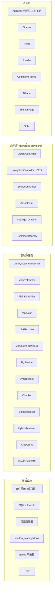
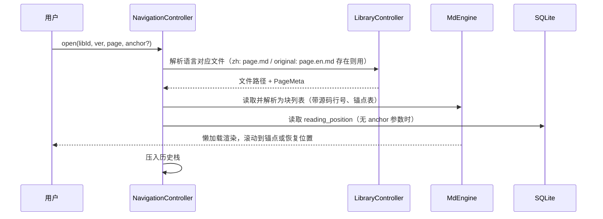

# 02 架构设计

## 1. 技术栈

依赖版本在实施时取 pub.dev 当前稳定版并在 pubspec.lock 中锁定；下表为选型与用途，标「候选」的在 M0 阶段做可行性验证后定稿。

| 用途 | 选型 | 说明 |
|------|------|------|
| UI 组件 | `fluent_ui` | Win11 Fluent 风格，NavigationView、CommandBar、ContentDialog、ComboBox 等 |
| 窗口控制 | `window_manager` | 无边框、置顶、透明度、位置大小、关闭拦截 |
| Mica 背景 | `flutter_acrylic` | Win11 Mica，Win10 退化 |
| 托盘 | `tray_manager` | 托盘图标与菜单 |
| 开机自启 | `launch_at_startup` | 写当前用户 Run 项，通过包的 API 操作 |
| 单实例 | `windows_single_instance`（候选） | 激活已运行实例 |
| 状态管理 | `flutter_riverpod` | 全局状态、依赖注入、异步加载 |
| Markdown 解析 | `markdown`（dart-lang） | 解析为 AST，自定义语法扩展（alerts、`{#id}`、math） |
| Markdown 渲染 | 自研块级渲染器 | 基于 AST 按顶层块生成 Widget，便于懒加载、查找高亮、锚点定位、源码行映射 |
| 代码高亮 | `re_highlight`（候选）/ `flutter_highlight` | highlight.js 规则移植 |
| LaTeX | `flutter_math_fork` | 行内与块级公式 |
| Mermaid | `webview_windows`（WebView2）+ 打包 `mermaid.min.js` | 离屏渲染为 PNG 并按源码 hash 缓存，见 7 节 |
| YAML front matter | `yaml` | 解析 front matter |
| SQLite | `sqlite3` + `sqlite3_flutter_libs` | 会话历史、向量索引、页面元数据缓存 |
| HTTP / SSE | `http` | OpenAI 兼容接口、流式输出自行解析 SSE |
| 凭据存储 | `win32`（FFI 调用 CredWriteW / CredReadW / CredDeleteW） | Windows 凭据管理器，目标名 `flDoc/chat`、`flDoc/embedding` |
| 路径 | `path`、`path_provider` | 应用数据目录 |
| 外部打开 | `url_launcher` | 系统浏览器、资源管理器 |
| 剪贴板 | Flutter `Clipboard` | 复制代码、提示词 |
| 拼音匹配 | `lpinyin`（候选） | 命令面板拼音首字母模糊匹配 |
| 全文搜索 | ripgrep `rg.exe`（打包） | `--json` 输出解析 |
| 安装包 | Inno Setup 6 | 打包 Release 目录 |

## 2. 分层与模块



模块职责：

| 模块 | 职责 |
|------|------|
| LibraryScanner / Watcher | 扫描库根目录，识别契约库/纯 Markdown 库；`Directory.watch(recursive: true)` 监听，1.5 秒防抖后对受影响库重载 |
| ManifestParser | 解析并校验 manifest.json、front matter、symbols.json，输出 `Library` / `LibraryVersion` / `TocNode` / `PageMeta` 模型 |
| PlainLibBuilder | 纯 Markdown 文件夹按目录结构自然排序生成 toc，标题取首个 `#`，否则用文件名 |
| Validator | 契约校验，输出带定位信息的问题列表，见 [03-文档库契约.md](03-文档库契约.md) 第 9 节 |
| LinkResolver | 相对链接解析；`source_url` 规范化映射表（去 fragment、query、末尾斜杠、协议与 `www.` 统一）；锚点查找 |
| MdEngine | 解析 Markdown 为块列表，每块记录源码起止行；生成 Widget；支持查找高亮注入 |
| NavigationController | 当前位置 `(libId, versionId, pagePath, anchor)`，后退/前进栈，阅读位置持久化 |
| RgService | 组装参数、启动 rg、流式解析 `--json`、取消、映射命中行到页面块 |
| SymbolIndex | 内存中加载各库 symbols.json，模糊匹配 |
| Chunker | 按标题切块，生成带面包屑的检索单元 |
| EmbedIndexer | 后台 isolate 增量调用嵌入接口，写入 SQLite |
| HybridRetriever | 关键词改写、rg 召回、向量召回、RRF 融合 |
| ChatClient | OpenAI 兼容 `/chat/completions`（流式）、`/models`、`/embeddings` |
| CommandRegistry | 统一注册命令（id、标题、分类、可用条件、执行器、子模式），命令面板与快捷键都通过它调用 |
| PromptBuilder | 导入提示词模板填参 |

## 3. 项目目录结构

```
C:/flutter/flDoc/
  doc/                         设计文档（本目录）
  lib/
    main.dart                  启动：单实例、窗口初始化、设置加载、ProviderScope
    app/
      app.dart                 FluentApp、主题、Shortcuts/Actions 根
      shell.dart               标题栏 + 三栏布局
      theme.dart
      shortcuts.dart           基础快捷键 -> 命令 id
    core/
      paths.dart               应用数据目录、默认库根目录
      slug.dart                锚点 slug 规则
      natural_sort.dart
      url_normalize.dart
      debounce.dart
      result.dart
    features/
      library/                 模型、扫描、监听、manifest/plain 解析、校验、生成 manifest
      reader/                  渲染器、代码块、mermaid、math、查找条、阅读位置
      sidebar/
      home/
      palette/                 命令面板 UI、子模式框架、命令注册表
      search/                  rg 服务、符号索引、结果模型
      ai/                      客户端、切块、嵌入索引、混合召回、RAG、会话历史、AI 面板
      settings/                模型、存储、迁移、凭据、设置页、OOBE
      window/                  标题栏、托盘、自启、窗口状态
      importer/                导入表单与提示词生成
  assets/
    prompts/import_prompt.md   导入提示词模板（与 04 文档同源）
    mermaid/mermaid.min.js
    mermaid/render.html
    icons/
  third_party/
    ripgrep/rg.exe             打包的 ripgrep 与 LICENSE
  test/
    fixtures/libraries/        样例契约库、纯 Markdown 库、错误库
  installer/
    flDoc.iss                  Inno Setup 脚本
  windows/                     runner；CMakeLists 增加 install 规则复制 rg.exe 到 exe 同目录
```

## 4. 数据存储

| 数据 | 位置 | 格式 |
|------|------|------|
| 文档库 | 用户配置的库根目录 | 见契约；flDoc 只读 |
| 设置 | `<AppSupport>/settings.json` | JSON，可手改 |
| UI 状态 | `<AppSupport>/state.json` | 窗口位置大小、侧栏宽度、最近命令、最近位置 |
| 数据库 | `<AppSupport>/fldoc.db` | SQLite：阅读位置、会话历史、向量索引、页面元数据缓存 |
| Mermaid 缓存 | `<AppSupport>/cache/mermaid/<sha256>-<theme>.png` | PNG |
| 日志 | `<AppSupport>/logs/fldoc-YYYYMMDD.log` | 文本，保留 7 天，不记录密钥与请求正文 |
| API Key | Windows 凭据管理器 | 目标名 `flDoc/chat`、`flDoc/embedding` |

`<AppSupport>` 为 `path_provider.getApplicationSupportDirectory()`，Windows 上通常是 `%APPDATA%\<公司名>\flDoc`。

### 4.1 SQLite 表

```sql
CREATE TABLE reading_position (
  lib_id TEXT, version_id TEXT, page_path TEXT,
  anchor TEXT, offset_ratio REAL, updated_at INTEGER,
  PRIMARY KEY (lib_id, version_id, page_path)
);

CREATE TABLE chunk (
  id INTEGER PRIMARY KEY,
  lib_id TEXT, version_id TEXT, page_path TEXT, lang TEXT,
  anchor TEXT, breadcrumb TEXT, text TEXT,
  content_hash TEXT, embed_model TEXT, dim INTEGER,
  vector BLOB,              -- float32 小端序，已 L2 归一化
  updated_at INTEGER
);
CREATE INDEX idx_chunk_scope ON chunk(lib_id, version_id);
CREATE UNIQUE INDEX idx_chunk_key ON chunk(lib_id, version_id, page_path, lang, anchor, content_hash);

CREATE TABLE chat_session (
  id TEXT PRIMARY KEY, title TEXT, scope TEXT,   -- scope: JSON {libId?, versionId?, all:bool}
  created_at INTEGER, updated_at INTEGER
);
CREATE TABLE chat_message (
  id INTEGER PRIMARY KEY, session_id TEXT, role TEXT,   -- user/assistant
  content TEXT, citations TEXT,                          -- JSON 数组
  created_at INTEGER
);
CREATE TABLE schema_meta (key TEXT PRIMARY KEY, value TEXT);
```

向量规模估算：5000 页约 3 万块，bge-m3 维度 1024，float32 约 120 MB；查询时在 isolate 中按库范围加载并暴力点积，3 万次 1024 维点积在毫秒到数十毫秒量级，不引入向量数据库扩展。

## 5. settings.json 结构

```json
{
  "schemaVersion": 1,
  "oobeCompleted": false,
  "libraryRoots": ["C:/Users/<user>/flDocLibrary"],
  "appearance": {
    "theme": "system",
    "accentColor": "#0078D4",
    "bodyFont": "Microsoft YaHei UI",
    "codeFont": "Cascadia Code",
    "fontSize": 15,
    "contentMaxWidth": 860,
    "mica": true
  },
  "reading": {
    "language": "zh",
    "fontScale": 1.0,
    "rememberPosition": true
  },
  "sidebar": {
    "collapsedMode": "hidden",
    "visible": true
  },
  "window": {
    "alwaysOnTop": false,
    "opacity": 1.0,
    "closeToTray": true,
    "launchAtStartup": false
  },
  "search": {
    "rgPath": "",
    "defaultScope": "currentLibrary",
    "caseMode": "smart",
    "maxResults": 300,
    "contextLines": 1,
    "debounceMs": 150
  },
  "ai": {
    "chat": {
      "baseUrl": "",
      "model": "",
      "temperature": 0.2,
      "maxTokens": 2048,
      "rewriteQuery": true
    },
    "embedding": {
      "baseUrl": "https://api.siliconflow.cn/v1",
      "model": "BAAI/bge-m3",
      "batchSize": 32,
      "autoIndex": true
    },
    "rag": {
      "topK": 8,
      "maxContextChars": 12000,
      "saveHistory": true
    },
    "suggestOnNoResult": true
  }
}
```

规则：

- 字段缺失用默认值，未知字段保留不删除；`schemaVersion` 升级时执行迁移函数。
- API Key 不出现在此文件；设置页通过凭据管理器读写，只显示掩码与「已配置/未配置」。
- `rgPath` 为空时使用 exe 同目录的 `rg.exe`。
- 外部修改 settings.json 后自动重载；JSON 无效时保持旧设置并提示行列号。

## 6. 关键数据流

### 6.1 打开页面



### 6.2 文档库变更

`Directory.watch` 事件 → 按路径归属到库 → 1.5 秒防抖 → 重载该库（manifest 失败时保留旧状态）→ 刷新侧栏/Home/符号索引 → 若当前页被修改则原位重载并保持阅读位置 → 通知 EmbedIndexer 增量索引。

## 7. Mermaid 渲染方案

- 启动后懒创建一个离屏 WebView2（`webview_windows`），加载本地 `assets/mermaid/render.html`（内含打包的 mermaid.min.js，不联网）。
- 渲染请求通过 `postMessage` 传源码与主题，页面返回 SVG 转 PNG 的 base64；写入缓存，键为 `sha256(源码)+主题`。
- 渲染队列串行处理，超时 5 秒视为失败，显示源码与错误。
- 未安装 WebView2 Runtime 时（Win10 少数情况）降级为显示源码，并在设置-关于中提示安装。
- 风险与替代：如 `webview_windows` 离屏渲染不可行，改为在可见区域内嵌 WebView2 控件显示该块；在 M0 做技术验证。

## 8. 安全设计

- rg 调用：`Process.start(rgPath, args, runInShell: false)`，用户输入只作为 `-e` 参数值或在 `--` 之后传入，不拼接命令行。
- Markdown 中的 HTML：只保留安全子集（`<a id>`、`<br>`、`<kbd>`、`<sub>`、`<sup>`、`<details>/<summary>`），其余按纯文本显示；不执行脚本。
- Mermaid WebView：只加载本地页面，禁止导航到外部 URL，securityLevel 设为 `strict`。
- 外链打开前校验协议仅允许 `http`、`https`、`mailto`。
- 密钥：凭据管理器存储；请求日志对 `Authorization` 头打码；崩溃日志不包含请求正文。
- 库路径校验：toc、链接、图片解析后的绝对路径必须位于该库目录内，防止 `../` 越界读取。
