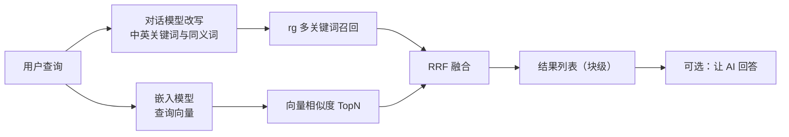
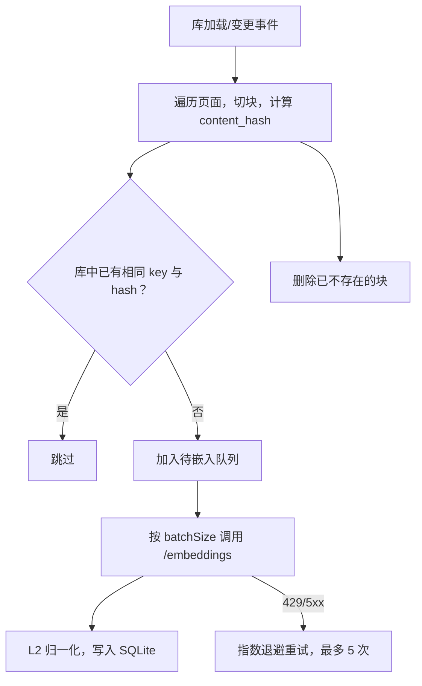

# 06 AI 检索与 RAG

## 1. 检索能力总览

| 能力 | 入口 | 依赖 | 网络 |
|------|------|------|------|
| 本页查找 | Ctrl+F | 渲染块文本 | 否 |
| 全局搜索 | 搜索: 全局搜索 | rg.exe | 否 |
| 符号搜索 | 搜索: 搜索符号/函数 | symbols.json + rg 兜底 | 否 |
| 打开页面 / 跳转标题 | 导航命令 | 内存索引 | 否 |
| AI 智能搜索 | 搜索: AI 智能搜索 / 全局搜索无结果时 | 对话模型（改写）+ 嵌入模型 + rg | 是 |
| RAG 问答 | AI 面板 / AI: 提问 | 同上 + 对话模型（生成） | 是 |

## 2. 全局搜索（rg）

### 2.1 参数组装

```
rg --json --no-config --no-ignore
   --glob "*.md" --glob "!**/assets/**"
   --max-columns 400 --max-columns-preview
   --max-count 50                       每个文件最多 50 处
   -C <contextLines>
   [--smart-case | --case-sensitive | --ignore-case]
   [--word-regexp]
   [--fixed-strings]                    非正则模式
   -e <用户输入>
   -- <搜索路径...>
```

- 搜索路径：当前库为「当前版本目录/pages」；全部库为每个库默认版本的 pages 目录（多版本库只搜默认版本，避免重复）。
- 语言：同时搜索 `.md` 与 `.en.md`，结果按页面合并；当前语言对应的文件命中排在前面。
- 进程：`runInShell: false`；新输入到达时 kill 上一个进程；总结果达到 `search.maxResults` 时 kill 并显示「结果过多，已截断」。
- 解析：逐行读 stdout 的 JSON 事件（`begin` / `match` / `context` / `end` / `summary`），按文件聚合；文件路径反查 `(libId, versionId, pagePath)` 与页面标题。
- 定位：命中行号 → MdEngine 块源码行号映射 → 滚动到对应块，并在块内高亮匹配文本（与 Ctrl+F 共用高亮机制）。front matter 行内的命中归到页面标题。

### 2.2 排序

1. 标题命中（front matter title 或 `##` 标题行）优先。
2. 当前语言文件优先。
3. 每页命中数降序。
4. 页面在 toc 中的顺序。

## 3. 符号搜索

1. 内存加载所有库的 symbols.json，建立 `name`、`qualifiedName`、`aliases` 的小写索引。
2. 匹配打分：完全相等 > 前缀 > 驼峰首字母缩写（如 `PS` 匹配 `ProviderScope`）> 子串 > 模糊。
3. 结果显示 kind、签名、所在页面；Enter 打开 page 并跳到 anchor。
4. 无符号结果或库无 symbols.json 时，自动执行 rg 兜底：
   - 正则：`\b<转义名>\b\s*[(<{:=]|class\s+<名>|<名>\s*\(`，`--case-sensitive`。
   - 只保留落在围栏代码块内的命中（由页面块索引判断行号区间）。
   - 结果标注「代码匹配」。

## 4. AI 智能搜索（混合召回）



### 4.1 关键词改写

请求对话模型（`temperature: 0`，要求只输出 JSON）：

```text
system: 你是文档检索助手。把用户的问题改写为用于全文检索的关键词。
只输出 JSON：{"keywords": [...], "symbols": [...]}。
keywords：3-8 个，中英文都要，包含同义词与英文技术术语；
symbols：问题中涉及的 API/类/函数名，没有则为空数组。
user: <查询>
```

- 解析失败或对话模型未配置时，退化为对原查询分词（按空白与中英文边界切分）。
- `symbols` 额外走符号索引，命中的符号所在块直接加入候选并给予加权。

### 4.2 rg 召回

每个关键词以 `--fixed-strings --ignore-case` 并行跑一次（最多 8 个进程，同一时刻并发 4 个），命中行归属到所在块（块定义同第 6 节切块），按块的命中关键词数与命中次数打分排序，取前 50。

### 4.3 向量召回

- 查询文本直接作为输入调用嵌入接口（bge-m3 支持中英跨语言）。
- 在 isolate 中加载范围内的块向量，点积（向量已归一化）取前 50。
- 范围：与全局搜索相同（当前库当前版本 / 全部库默认版本）。
- 嵌入模型未配置或索引未就绪：跳过向量召回，结果顶部提示「向量索引不可用，仅关键词结果」并给出原因（未配置 / 索引构建中 x% / 构建失败）。

### 4.4 RRF 融合

```
score(d) = Σ  1 / (60 + rank_i(d))      i ∈ {rg, vector, symbol}
```

- 同一页面同一锚点的中英两块合并为一条，保留当前语言的块用于展示。
- 输出前 20 条到命令面板：页面标题 / 小节面包屑 / 片段预览 / 来源标记（关键词、语义、符号）。
- 列表顶部固定项「让 AI 基于这些结果回答」。

## 5. RAG 问答

### 5.1 流程

1. 用户在 AI 面板输入问题（或从 AI 智能搜索结果进入）。
2. 检索查询 = 当前问题；多轮时先让对话模型结合最近 3 轮把追问改写为独立问题（`temperature: 0`），再执行第 4 节混合召回。
3. 取融合后前 `ai.rag.topK`（默认 8）块，按 `maxContextChars` 截断，组装上下文，编号 `[1]..[n]`。
4. 调用 `/chat/completions`，`stream: true`，SSE 逐段渲染。
5. 回答完成后解析正文中的 `[n]`，转为可点击引用；面板底部列出引用来源（页面标题 + 小节 + 库名）。

### 5.2 提示词

```text
system:
你是 flDoc 文档助手。只依据下面提供的文档片段回答用户问题，使用简体中文。
规则：
1. 每个事实陈述后用 [编号] 标注出处，编号对应片段编号；可以标多个，如 [1][3]。
2. 片段不足以回答时，明确说明「文档中未找到相关内容」，并给出可能相关的片段编号；不要编造 API 或参数。
3. 代码示例优先使用片段中的原始代码，使用围栏代码块并标注语言。
4. 回答简洁，先给结论再给步骤。

文档片段：
[1] <库名> / <页面标题> / <小节面包屑>
<片段正文>

[2] ...

user: <问题>
```

多轮时把历史消息（不含旧片段，仅问答文本）放在 system 与当前 user 之间，最多保留最近 6 条。

### 5.3 AI 面板

- 位置：窗口右侧，可拖动宽度，可收起（命令 `ai.togglePanel`），收起状态持久化。
- 顶部：会话标题（首个问题自动截取）、范围芯片（当前库 / 全部库）、新建、历史。
- 消息：Markdown 渲染（与正文同一渲染器，含代码复制）；流式过程中显示停止按钮。
- 引用：正文中的 `[n]` 渲染为小号强调色角标，悬停预览片段，点击在正文区打开页面并滚动高亮该块。
- 错误：网络错误、401、429、超时分别给出中文提示与「重试」按钮；401 附「打开对话模型配置」。
- 历史：`ai.rag.saveHistory` 开启时写入 SQLite（chat_session / chat_message，citations 存块定位信息 `{libId, versionId, page, anchor, title}`）；关闭时会话仅存在内存。

## 6. 切块与向量索引

### 6.1 切块规则

- 以 `##` / `###` 标题为边界切分；标题下内容超过 1500 字符时按段落再切，相邻块重叠 1 段。
- 小于 200 字符的块并入前一块。
- 代码块不拆分；单个代码块超过 3000 字符时截断参与嵌入（全文仍保留用于展示）。
- 每块嵌入文本 = `库名 / 页面标题 / 面包屑\n` + 块正文（去掉图片与链接 URL，保留链接文字）。
- 中文页与原文页都切块入库（`lang` 字段区分），提升跨语言召回。

### 6.2 增量构建



- 运行在后台 isolate，不阻塞 UI；Home 卡片显示「索引中 63%」「已就绪」「失败（原因）」。
- 嵌入模型或 base_url 变更后，旧向量（`embed_model` 不同）全部失效，提示重建。
- `ai.embedding.autoIndex` 关闭时只在用户执行「重建向量索引」时构建。
- 估算与提示：首次构建前显示块数量；块数超过 2 万时二次确认。

### 6.3 嵌入接口

- `POST {baseUrl}/embeddings`，body：`{"model": "...", "input": ["...", "..."], "encoding_format": "float"}`。
- 默认 `https://api.siliconflow.cn/v1` + `BAAI/bge-m3`（1024 维，输入上限 8192 token）。
- 维度以首次返回结果为准写入 `dim`，查询时校验一致。

## 7. 对话模型接口

- OpenAI 兼容：`GET {baseUrl}/models`（拉取模型列表）、`POST {baseUrl}/chat/completions`。
- 请求头：`Authorization: Bearer <key>`，key 运行时从凭据管理器读取，不缓存到磁盘。
- 流式：解析 `data: {...}` 行，取 `choices[0].delta.content`；`data: [DONE]` 结束。若返回 `reasoning_content`（推理模型），在面板中以可折叠「思考过程」显示，不计入引用解析。
- 超时：连接 10 秒，首包 60 秒，总时长 5 分钟。
- 「测试连接」：对话模型发送 `ping` 短请求（`max_tokens: 1`）；嵌入模型嵌入 `"flDoc"`，显示维度与耗时。

## 8. 未配置 AI 时的引导

触发 AI 功能（AI 智能搜索、AI 面板发送、就当前页提问）时检查：

| 状态 | 行为 |
|------|------|
| 对话模型与嵌入模型都未配置 | ContentDialog：「尚未配置 AI」，按钮「去配置」（打开设置页 AI 分区）/「取消」 |
| 仅嵌入模型未配置 | 允许继续，结果顶部提示「仅关键词检索」，附「配置嵌入模型」链接 |
| 仅对话模型未配置 | AI 智能搜索可用（跳过改写，仅向量 + 分词 rg）；RAG 问答弹出引导对话框 |

## 9. OOBE（首次启动向导）

`oobeCompleted` 为 false 时启动进入向导，全屏 ContentDialog 分步，每步「跳过」「上一步」「下一步」：

1. 欢迎：一句话介绍与三步说明（导入、阅读、提问）。
2. 文档库：默认 `%USERPROFILE%\flDocLibrary`（不存在则创建），可添加多个根目录。
3. 对话模型：base_url、API Key、模型（「获取模型列表」后下拉选择）、测试连接；可跳过。
4. 嵌入模型：预填硅基流动 base_url 与 `BAAI/bge-m3`，填写 API Key 并测试；可跳过。
5. 外观：主题、强调色、字号预览。
6. 完成：提示可用 Ctrl+Shift+P 打开命令面板、可用「导入文档库」生成爬取提示词；按钮「导入第一个文档库」「进入 Home」。

可通过命令「首选项: 重新运行初始设置向导」再次进入。API Key 输入框为密码框，保存后只显示掩码。
