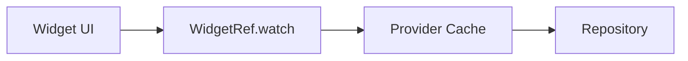

## Install dependencies {#install-dependencies}

Before using Riverpod in a Flutter app, add `flutter_riverpod` to `pubspec.yaml`, then read [Reading a Provider](concepts/reading.en.md#using-refwatch).

```dart
import 'package:flutter/material.dart';
import 'package:flutter_riverpod/flutter_riverpod.dart';

void main() {
  runApp(const ProviderScope(child: MyApp()));
}
```

> [!TIP]
> Wrapping the root widget in `ProviderScope` is required to store provider state and enable `overrides` in tests.

## Feature checklist {#feature-matrix}

- [x] Compile-time safe and auto-cached
- [x] Async `FutureProvider` and `StreamProvider`
- [ ] Optional code generation

| Feature | Description | Use case |
|:--------|:-----------:|---------:|
| `ref.watch` | Reactively listens for updates | Inside `build` |
| `ref.read` | Reads value once | Event callbacks |

## Architecture and formula {#architecture-demo}

Update complexity is $O(V + E)$:

$$
\text{RRF}(d) = \sum_{i} \frac{1}{60 + \text{rank}_i(d)}
$$



